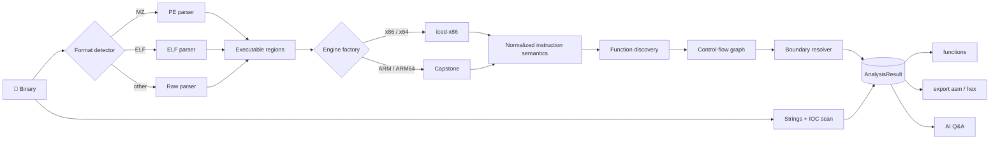

<h1 align="center">🔬 BinaryAnalyzerCLI</h1>

<p align="center">
  <b>Quick static smell-tests for PE, ELF, and bare binary blobs — straight from the terminal.</b><br/>
  Chunked disassembly · function boundary recovery · strings &amp; suspicious Win32/libc calls · optional OpenRouter LLM triage
</p>

<p align="center">
  
  
  
</p>

<p align="center">
  
  
  
</p>

<p align="center">
  <a href="#-highlights">Highlights</a> ·
  <a href="#-quick-start">Quick start</a> ·
  <a href="#-commands">Commands</a> ·
  <a href="#-configuration">Configuration</a> ·
  <a href="#-how-it-works">How it works</a> ·
  <a href="#-ai-assisted-review">AI review</a> ·
  <a href="#-limitations">Limitations</a> ·
  <a href="DISCLAIMER.md">Disclaimer</a>
</p>

---

> [!WARNING]
> **Early alpha preview.** The scanner produces rough heuristic triage signals, not definitive verdicts. Check [DISCLAIMER.md](DISCLAIMER.md) before throwing live malware or sensitive payloads at this tool.

## 🎯 What is this?

When you get handed an unknown binary blob, firing up Ghidra or IDA just to see what headers it has, whether it drops threads into remote processes, or what strings sit inside is overkill. **BinaryAnalyzerCLI** does that initial 30-second sanity check without leaving your shell. Feed it a file; it works out the file format, detects the ISA, sweeps through instructions in small memory-conscious chunks, carves candidate function boundaries, extracts ASCII/Unicode strings, and flags common API abuse patterns. If you need a second pair of eyes, you can query an LLM on the extracted context.

Architecture-wise, it runs as an interactive REPL shell built on .NET 10 (C# 13), keeping state between operations so you do not have to reload binaries between scans.

## ✨ Highlights

<table>
<tr>
<td width="50%" valign="top">

### 🧩 Dual Disassembly Backends
Uses **iced-x86** for fast managed x86/x64 decoding and hands ARM/ARM64 over to **Capstone** via native bindings. If you inspect an ARM binary, the engine switch happens silently behind the scenes, and the tool pins whichever engine decoded the bytes so replays stay bit-exact.

</td>
<td width="50%" valign="top">

### 🌊 Memory-Conscious Chunked Sweeps
Instead of allocating millions of instruction objects upfront, disassembly processes in 256 KiB ring slices with auto-resync. Functions get re-decoded on the fly when you inspect them in the shell, keeping peak memory low on large binaries.

</td>
</tr>
<tr>
<td valign="top">

### 🧭 Multi-Heuristic Function Recovery
Combines PE `.pdata` exception unwinding records (authoritative for x64/ARM64), binary entry points, direct `CALL` targets, prologue signatures (`push rbp`, `stp x29, x30`), tail `JMP`s, and contiguous data-section pointer tables into a unified CFG boundary resolver.

</td>
<td valign="top">

### 🚨 API Triage &amp; Dynamic Import Matching
Tracks 35 indicators across 6 abuse categories. It checks both the compiled IAT and embedded raw strings — meaning functions resolved dynamically at runtime through `GetProcAddress` or loaded via `LoadLibrary` still get caught.

</td>
</tr>
<tr>
<td valign="top">

### 🤖 OpenRouter LLM Inspection (Optional)
Pipe the triage report and head assembly into any model hosted on [OpenRouter](https://openrouter.ai). This is entirely optional and stays out of your way unless you run `ai analys`.

</td>
<td valign="top">

### 📤 Flat-File Disassembly &amp; Hex Dumps
Dump entire disassembled sections to `ASM.txt` or generate classic canonical hex dumps (`offset | hex | ascii`) to `hex.txt` without keeping full buffers in memory.

</td>
</tr>
</table>

## 🎬 Terminal Walkthrough

> Example REPL run on a 64-bit Windows executable. Output format and addresses match actual runtime output.

```text
  ____  _                            _                _                     _____ _     ___
 | __ )(_)_ __   __ _ _ __ _   _    / \   _ __   __ _| |_   _ _______ _ __ / ____| |   |_ _|
 |  _ \| | '_ \ / _` | '__| | | |  / _ \ | '_ \ / _` | | | | |_  / _ \ '__| |    | |    | |
 | |_) | | | | | (_| | |  | |_| | / ___ \| | | | (_| | | |_| |/ /  __/ |  | |____| |___ | |
 |____/|_|_| |_|\__,_|_|   \__, |/_/   \_\_| |_|\__,_|_|\__, /___\___|_|   \_____|_____|___|
                            |___/                        |___/

BinaryAnalyzerCLI> open sample.exe
Opened: sample.exe
  Format:       PE
  Architecture: X64 (64-bit)
  Size:         1,482,752 bytes
  EntryPoint:   0x1400012A0
  Sections:     6
  Imports:      214 functions / 9 libraries

BinaryAnalyzerCLI> analyze
Disassembling sample.exe using Iced engine...
Progress: [██████████████████████████████] 100%
Disassembly complete.
  Engine used:           Iced
  Instructions decoded:  184,213
  Estimated functions:   1,042
  Strings extracted:     3,881
  Suspicious API hits:   6
  Duration:              1.84s
Suspicious API usage detected:
    - VirtualAlloc [MemoryAllocation]
    - CreateRemoteThread [ProcessInjection]
    - LoadLibraryA [DynamicLoading]

BinaryAnalyzerCLI> functions
Functions: 1042
 #    Start Address      End Address        Instructions  Source             Confirmations
------------------------------------------------------------------------------------------
 1    0x140001000        0x14000103F        17            unwind             2
 2    0x1400012A0        0x1400012D7        14            entrypoint         3
 ...
Select function number (or 'q' to cancel): 2
```

## 🚀 Quick start

### Prerequisites

- [.NET 10 SDK](https://dotnet.microsoft.com/download)
- Working connection for NuGet packages during the first restore
- Native Capstone binaries get pulled in by `Gee.External.Capstone` automatically across Linux, macOS, and Windows.

### Building from source

```bash
git clone https://github.com/gf958457-sys/BinaryAnalyzerCLI.git
cd BinaryAnalyzerCLI

dotnet build -c Release
dotnet run -c Release
```

To analyze a file right away without waiting for the welcome banner:

```bash
dotnet run -c Release -- open path/to/sample.exe
```

### Standalone binary publish

```bash
dotnet publish -c Release -o out
./out/BinaryAnalyzerCLI        # Linux / macOS
out\BinaryAnalyzerCLI.exe      # Windows
```

### Typical run sequence

```text
open <path>  →  analyze  →  functions  →  export asm  →  ai analys
```

## ⌨️ Command reference

| Command | Action |
| --- | --- |
| `open <path>` | Ingests binary; parses headers, identifies ISA, reads sections &amp; import descriptors |
| `analyze` | Triggers full pipeline: streaming decode, string harvest, API matching, CFG construction |
| `functions` | Shows recovered routines with confidence scores; enter an index to dump its assembly |
| `export asm` | Streams full decoded disassembly out to `ASM.txt` inside the export folder |
| `export hex` | Dumps raw byte offsets and ASCII column to `hex.txt` (works standalone without running `analyze` first) |
| `ai analys` | Drops into the interactive LLM prompt (type `back` when you want to return to REPL) |
| `settings` | Configurator wizard for active disassembler, export paths, and AI flags |
| `help` | Prints supported command list |
| `exit` / `quit` | Terminates CLI session |

*Note: Commands are case-insensitive. Multi-word commands match using longest-prefix rules.*

## ⚙️ Configuration files

On its first start, the tool drops two configuration files into the working directory. Most settings can be adjusted on the fly through the `settings` command.

<details open>
<summary><b>Settings.json</b></summary>

```json
{
  "Disassembler": "Iced",
  "Architecture": "Auto",
  "ExportDirectory": "Exports",
  "AIEnabled": true,
  "OutputFormat": "Text"
}
```

| Key | Options | Behavior |
| --- | --- | --- |
| `Disassembler` | `Iced`, `Capstone` | iced-x86 works for x86/x64 only. Capstone handles ARM and ARM64 |
| `Architecture` | `Auto`, `x86`, `x64`, `arm`, `arm64` | `Auto` derives ISA from binary headers. **Mandatory override for raw firmware / shellcode blobs** (must be edited directly in JSON) |
| `ExportDirectory` | arbitrary directory path | Target folder for generated `ASM.txt` and `hex.txt` files |
| `AIEnabled` | `true` / `false` | Toggles the `ai analys` command branch |
| `OutputFormat` | `Text` | Output formatting mode |

</details>

<details>
<summary><b>Ai.json</b></summary>

```json
{
  "Provider": "OpenRouter",
  "ApiKey": "YOUR_KEY",
  "Model": "anthropic/claude-sonnet-5",
  "Endpoint": "https://openrouter.ai/api/v1/chat/completions",
  "Temperature": 0.2,
  "MaxTokens": 4096
}
```

> [!IMPORTANT]
> Paste your API token in `Ai.json` before firing up the interactive AI shell. Keys sit unencrypted on disk, so never commit this file back to version control. Running `git update-index --skip-worktree Ai.json` locally is strongly advised.

</details>

## 🔬 Internal pipeline



### Function discovery confidence tiers

The resolver tags candidate functions with their origin evidence. High-confidence sources always override weaker guesses when addresses collide.

| Origin | Detection mechanism | Reliability |
| --- | --- | --- |
| `unwind` | PE `.pdata` `RUNTIME_FUNCTION` table (x64 / ARM64) | Authoritative (compiler-generated) |
| `entrypoint` | Primary executable entry point from file header | Ground-truth entry |
| `directcalltarget` | Immediate target operand from direct `CALL` instruction | Medium |
| `prologue` | Standard stack frame setup (`push rbp`, `stp x29, x30`) | Heuristic guess |
| `tailjmptarget` | Direct unconditional `JMP` landing address | Low |
| `datapointertarget` | Series of $\ge 2$ consecutive code addresses found in data sections | Weakest hint |

The `Confirmations` tally in the function viewer indicates how many separate heuristics flagged that exact address.

### 🚨 Monitored API signatures

| Category | Rules | Common targets |
| --- | :---: | --- |
| `ProcessInjection` | 6 | `CreateRemoteThread`, `NtCreateThreadEx`, `QueueUserAPC` |
| `MemoryAllocation` | 5 | `VirtualAlloc`, `VirtualProtectEx`, `NtMapViewOfSection` |
| `DynamicLoading` | 5 | `LoadLibraryA/W`, `GetProcAddress` |
| `CommandExecution` | 8 | `CreateProcessA/W`, `ShellExecuteA/W`, `WinExec`, `system` |
| `NetworkActivity` | 6 | `URLDownloadToFileA`, `InternetOpenUrlA`, `connect` |
| `Persistence` | 5 | `RegSetValueExA/W`, `CreateServiceA` |

To prevent spurious hits on common English words, short names like `system` or `send` only trigger matches if they appear in explicit invocation or export format (e.g. `system(...)` or `libc!system`), not as stray prose.

## 🤖 LLM-assisted triage

Running `ai analys` spins up a sub-shell that attaches parsed binary metadata to your query context.

> [!CAUTION]
> **Data outbound notice.** When using this feature, the following payloads are submitted to OpenRouter and downstream model providers:
>
> - File metadata: name, format, architecture, image size, entry point, section layout, and linked import table
> - All identified suspicious API calls
> - The **first 4,000 instructions** (virtual address, raw bytes, mnemonic text)
> - The **first 200 extracted strings**
> - Your typed prompt
>
> Do not point this at proprietary binaries, embargoed vulnerability drops, or files under non-disclosure agreements. Model responses can hallucinate control flow — treat them as hints and verify against raw disassembly. See [DISCLAIMER.md](DISCLAIMER.md).

Models can be swapped on the fly by changing the `Model` property in `Ai.json` (or via `settings` option 5).

## 📤 Output dumps

<table>
<tr>
<td valign="top">

**`ASM.txt` sample**

```text
; BinaryAnalyzerCLI disassembly export
; File: sample.exe
; Format: PE  Architecture: X64
; Engine: Iced  Instructions: 184213

00401000:
55
push rbp

00401001:
4889E5
mov rbp,rsp
```

</td>
<td valign="top">

**`hex.txt` sample**

```text
OFFSET    | BYTES                                           | ASCII
------------------------------------------------------------------------
00000000  | 4D 5A 90 00 03 00 00 00 04 00 00 00 FF FF 00 00 | MZ..............
```

</td>
</tr>
</table>

## 🗺️ Compatibility matrix

| Subsystem | Coverage |
| --- | --- |
| **Formats** | PE32 / PE32+ (headers, sections, import table, `.pdata`) · ELF32 / ELF64 (headers and section headers) · Raw flat memory dumps |
| **ISAs** | x86 · x64 · ARM · ARM64 |
| **Engines** | iced-x86 (`1.21.0`) · Capstone via `Gee.External.Capstone` (`2.3.0` linking against native Capstone **4.0**) |
| **Platforms** | Windows, Linux, and macOS. Native Capstone libraries ship embedded in NuGet packages. Main dev work happens on Windows; cross-platform CI matrix is currently in progress. |

## 🧱 Architectural design

<details>
<summary><b>Source tree layout</b></summary>

```text
BinaryAnalyzerCLI/
├── Core/
│   ├── Interfaces/      IDisassemblerEngine · IBinaryParser · IAIProvider · IExporter · …
│   ├── Models/          InstructionInfo + InstructionSemantics · FunctionInfo · AnalysisResult · …
│   └── ControlFlow/     BasicBlock · CfgEdge · ControlFlowGraph(+Builder)
├── Disassembler/
│   ├── Iced/            engine + semantic adapter
│   ├── Capstone/        engine + semantic adapter + native-load diagnostics
│   └── DisassemblerEngineFactory.cs
├── Analysis/            PE/ELF/Raw parsers · function discovery · boundary resolver ·
│                        strings · suspicious-API scanner · StaticAnalysisService
├── AI/                  AiAnalysisService · OpenRouter provider
├── Export/              AssemblyExporter · HexExporter
├── Config/              SettingsManager (Settings.json + Ai.json)
├── CLI/                 CommandRouter · ConsoleUI · Commands/
├── Tests/               xUnit regression suite
└── Program.cs           DI container + REPL loop
```

</details>

**Implementation decisions**

- **Dependency Injection**: Disassembly engines, parsers, exporters, and AI clients are resolved through standard `Microsoft.Extensions.DependencyInjection`.
- **Semantic Normalization**: Both Capstone and iced-x86 translate instructions into a unified `InstructionSemantics` struct (control flow, memory access, operands). Analysis code works entirely on semantics and never depends on engine-specific mnemonics.
- **Fail-Fast Error Handling**: If Capstone native libraries fail to load (e.g. missing dependencies), the CLI surfaces a targeted error rather than producing silent partial disassemblies.

### Adding new components

| Extension task | Steps required |
| --- | --- |
| New disassembler backend | Implement `IDisassemblerEngine`, bind it in `Program.cs`, add factory dispatch branch in `DisassemblerEngineFactory` |
| Additional LLM provider | Implement `IAIProvider` and update the typed HTTP client registration |
| Custom export format | Implement `IExporter` and create a command patterned after `ExportAsmCommand` |
| New container format (e.g. Mach-O) | Implement `IBinaryParser` and register it alongside `PeAnalyzer` / `ElfAnalyzer` |
| New REPL verb | Implement `ICommand` and register it with `RegisterCommand<T>()` in `Program.cs` |

## 🧪 Running tests

```bash
dotnet test Tests/BinaryAnalyzerCLI.Tests.csproj -c Release
```

The xUnit test suite covers PE and ELF parsing, ring-buffer streaming resync, semantic parity between Iced and Capstone on identical x86/x64 bytes, CFG edge creation, API signature triggers, and fallback handling when native libraries are missing.

## 🚩 Known limitations &amp; caveats

Keep in mind this is an **early alpha release**:

- **Heuristic outputs**: Boundary resolution, CFG construction, and API flags are triage suggestions, not decompilation proof.
- **Purely static**: No dynamic emulation, unpacking, or deobfuscation. Heavily packed or crypted binaries won't yield meaningful code listings.
- **Capstone version**: Uses native Capstone 4.0 bindings; Capstone 5 instruction extensions are not available.
- **ELF symbol depth**: Parses headers and section entries only; ELF does not parse full dynamic symbols yet, so API checks on ELF rely on string matches.
- **Out of scope**: No Mach-O parser, no decompiler, no GUI.
- **Raw firmware blobs**: Requires setting `Architecture` manually in `Settings.json`. If left on `Auto`, disassembly skips raw files.
- **Memory footprint**: The target binary gets mapped into process memory; extremely large samples (e.g. multi-gigabyte ISOs) will consume proportional RAM.
- **Command spelling**: The command is deliberately named `ai analys` (single s).

## 🤝 Contributing

PRs and issue reports are welcome. When filing a bug, please include sample architecture, file format, the active engine, and the exact command order that triggered the failure. **Never attach live malware or proprietary samples to GitHub issues** — write a synthetic test case or describe the byte sequence instead.

## ⚖️ Legal &amp; License

- Distributed under the **[MIT License](LICENSE)**.
- Review [DISCLAIMER.md](DISCLAIMER.md) regarding safe analysis of unknown software, cloud data transmission, and legal usage boundaries.

## 🙏 Dependencies &amp; Credits

| Library | Function |
| --- | --- |
| [iced-x86](https://github.com/icedland/iced) | High-performance managed x86/x64 disassembler |
| [Capstone](https://www.capstone-engine.org) | Multi-architecture disassembly engine |
| [Gee.External.Capstone](https://github.com/9ee1/Capstone.NET) | .NET P/Invoke bridge for Capstone |
| [Microsoft.Extensions.*](https://github.com/dotnet/runtime) | DI, hosting, HTTP client abstractions |
| [OpenRouter](https://openrouter.ai) | Multi-model LLM API routing |

<p align="center">
  <sub>If this saves you time in triage, drop a ⭐ on the repository.</sub>
</p>

<div align="right">
  <a href="#readme">⬆ back to top</a>
</div>
