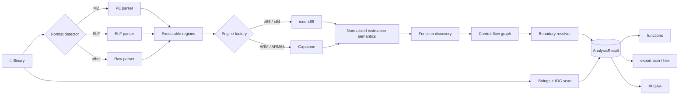

<h1 align="center">🔬 BinaryAnalyzerCLI</h1>

<p align="center">
  <b>First-pass static triage for PE, ELF and raw binaries — right in your terminal.</b><br/>
  Streaming disassembly · function discovery · string &amp; suspicious-API extraction · optional AI-assisted review
</p>

<p align="center">
  
  
  
</p>

<p align="center">
  
  
  
</p>

<p align="center">
  
  
  
</p>

<p align="center">
  <a href="#-highlights">Highlights</a> ·
  <a href="#-quick-start">Quick start</a> ·
  <a href="#-commands">Commands</a> ·
  <a href="#-configuration">Configuration</a> ·
  <a href="#-how-it-works">How it works</a> ·
  <a href="#-ai-assisted-review">AI review</a> ·
  <a href="#-limitations">Limitations</a> ·
  <a href="DISCLAIMER.md">Disclaimer</a>
</p>

---

> [!WARNING]
> **Early alpha.** Results are heuristic triage hints, not verdicts. Read the [DISCLAIMER](DISCLAIMER.md) before analysing untrusted samples or using the AI feature.

## 🎯 What is it?

**BinaryAnalyzerCLI** answers the question *"what am I looking at?"* in seconds. Point it at an executable and it identifies the format and architecture, streams a full disassembly, discovers functions, pulls out strings, flags API usage that is commonly abused by malware, and — if you want — lets you ask an LLM questions about the result.

It is an interactive console tool (a persistent REPL, like a debugger shell), written in modern C# on .NET 10.

## ✨ Highlights

<table>
<tr>
<td width="50%" valign="top">

### 🧩 Two interchangeable engines
**iced-x86** (pure managed, x86/x64) and **Capstone** (x86, ARM, ARM64). ARM/ARM64 automatically falls back to Capstone, and the engine that *actually* decoded the bytes is remembered for every later replay.

</td>
<td width="50%" valign="top">

### 🌊 Streaming by design
Disassembly runs in 256 KiB chunks with resync and a live progress bar. Instruction objects are transient — a function is re-decoded on demand when you open it, never kept in a giant list.

</td>
</tr>
<tr>
<td valign="top">

### 🧭 Layered function discovery
Entry point, direct `CALL` targets, prologue patterns, PE `.pdata` unwind records, tail-`JMP` targets and data-section function-pointer tables — merged, validated against executable regions and resolved into boundaries with a control-flow graph.

</td>
<td valign="top">

### 🚨 Suspicious-API triage
35 signatures in 6 behaviour categories, matched against both the import table and embedded strings (to catch APIs resolved dynamically via `GetProcAddress`).

</td>
</tr>
<tr>
<td valign="top">

### 🤖 Optional AI Q&amp;A
Ask free-form questions about the analysed binary through any model available on [OpenRouter](https://openrouter.ai). Fully optional and off the critical path.

</td>
<td valign="top">

### 📤 Clean exports
Write the full listing to `ASM.txt` and a classic *offset | bytes | ASCII* dump to `hex.txt`, streamed straight to disk.

</td>
</tr>
</table>

## 🎬 Demo

> Illustrative session — numbers and addresses are examples; the layout matches real output.

```text
  ____  _                            _                _                     _____ _     ___
 | __ )(_)_ __   __ _ _ __ _   _    / \   _ __   __ _| |_   _ _______ _ __ / ____| |   |_ _|
 |  _ \| | '_ \ / _` | '__| | | |  / _ \ | '_ \ / _` | | | | |_  / _ \ '__| |    | |    | |
 | |_) | | | | | (_| | |  | |_| | / ___ \| | | | (_| | | |_| |/ /  __/ |  | |____| |___ | |
 |____/|_|_| |_|\__,_|_|   \__, |/_/   \_\_| |_|\__,_|_|\__, /___\___|_|   \_____|_____|___|
                            |___/                        |___/

BinaryAnalyzerCLI> open sample.exe
Opened: sample.exe
  Format:       PE
  Architecture: X64 (64-bit)
  Size:         1,482,752 bytes
  EntryPoint:   0x1400012A0
  Sections:     6
  Imports:      214 functions / 9 libraries

BinaryAnalyzerCLI> analyze
Disassembling sample.exe using Iced engine...
Progress: [██████████████████████████████] 100%
Disassembly complete.
  Engine used:           Iced
  Instructions decoded:  184,213
  Estimated functions:   1,042
  Strings extracted:     3,881
  Suspicious API hits:   6
  Duration:              1.84s
Suspicious API usage detected:
    - VirtualAlloc [MemoryAllocation]
    - CreateRemoteThread [ProcessInjection]
    - LoadLibraryA [DynamicLoading]

BinaryAnalyzerCLI> functions
Functions: 1042
 #    Start Address      End Address        Instructions  Source             Confirmations
------------------------------------------------------------------------------------------
 1    0x140001000        0x14000103F        17            unwind             2
 2    0x1400012A0        0x1400012D7        14            entrypoint         3
 ...
Select function number (or 'q' to cancel): 2
```

## 🚀 Quick start

### Requirements

- [.NET 10 SDK](https://dotnet.microsoft.com/download)
- Internet access on the first build (NuGet restore)
- Native Capstone libraries are pulled in automatically by `Gee.External.Capstone` (Windows, Linux, macOS)

### Build &amp; run

```bash
git clone https://github.com/gf958457-sys/BinaryAnalyzerCLI.git
cd BinaryAnalyzerCLI

dotnet build -c Release
dotnet run -c Release
```

You can also hand it a command on startup — it runs, then drops you into the prompt:

```bash
dotnet run -c Release -- open path/to/sample.exe
```

### Publish a standalone build

```bash
dotnet publish -c Release -o out
./out/BinaryAnalyzerCLI        # Linux / macOS
out\BinaryAnalyzerCLI.exe      # Windows
```

### Your first analysis

```text
open <path>  →  analyze  →  functions  →  export asm  →  ai analys
```

## ⌨️ Commands

| Command | What it does |
| --- | --- |
| `open <path>` | Load a file; detect format, architecture, entry point, sections and imports |
| `analyze` | Run disassembly, string extraction, API scan, function discovery and CFG build |
| `functions` | List discovered functions, then pick one to view its disassembly |
| `export asm` | Write the full listing to `ASM.txt` in the export directory |
| `export hex` | Write an *offset \| bytes \| ASCII* dump to `hex.txt` (no prior `analyze` required) |
| `ai analys` | Enter an interactive AI Q&A prompt about the last analysis (`back` to leave) |
| `settings` | Interactive editor for engine, output format, export directory and AI options |
| `help` | List all commands |
| `exit` / `quit` | Leave the program |

Commands are case-insensitive. Multi-word commands are matched longest-first.

## ⚙️ Configuration

Two JSON files live next to the executable and are created with defaults on first run. Most values can be changed live with the `settings` command.

<details open>
<summary><b>Settings.json</b></summary>

```json
{
  "Disassembler": "Iced",
  "Architecture": "Auto",
  "ExportDirectory": "Exports",
  "AIEnabled": true,
  "OutputFormat": "Text"
}
```

| Key | Values | Notes |
| --- | --- | --- |
| `Disassembler` | `Iced`, `Capstone` | iced-x86 covers x86/x64 only; ARM/ARM64 always uses Capstone |
| `Architecture` | `Auto`, `x86`, `x64`, `arm`, `arm64` | `Auto` uses the detected architecture. **Required for raw binaries** — set it here (not available in the `settings` menu) |
| `ExportDirectory` | any path | Where `ASM.txt` and `hex.txt` are written |
| `AIEnabled` | `true` / `false` | Master switch for `ai analys` |
| `OutputFormat` | `Text` | |

</details>

<details>
<summary><b>Ai.json</b></summary>

```json
{
  "Provider": "OpenRouter",
  "ApiKey": "YOUR_KEY",
  "Model": "anthropic/claude-sonnet-5",
  "Endpoint": "https://openrouter.ai/api/v1/chat/completions",
  "Temperature": 0.2,
  "MaxTokens": 4096
}
```

> [!IMPORTANT]
> Set your API key **before launching** the tool. The key is stored in plain text, so **never commit a real key**. After cloning, consider `git update-index --skip-worktree Ai.json` so local edits are never staged.

</details>

## 🔬 How it works



### Function discovery sources

Every candidate is recorded together with *how* it was found, and weaker evidence never downgrades a stronger source for the same address.

| Source | Evidence | Confidence |
| --- | --- | --- |
| `unwind` | PE `.pdata` `RUNTIME_FUNCTION` entries (x64 / ARM64) | Authoritative |
| `entrypoint` | Binary entry point | Strongest available |
| `directcalltarget` | Target of a direct `CALL` | Medium |
| `prologue` | `push rbp` / `stp x29, x30` patterns | Weak |
| `tailjmptarget` | Target of a direct unconditional `JMP` | Weakest |
| `datapointertarget` | Entry in a data-section run of ≥ 2 consecutive code pointers | Weakest |

The `Confirmations` column in `functions` shows how many independent sources agreed on a function start.

### 🚨 Suspicious-API categories

| Category | Signatures | Examples |
| --- | :---: | --- |
| `ProcessInjection` | 6 | `CreateRemoteThread`, `NtCreateThreadEx`, `QueueUserAPC` |
| `MemoryAllocation` | 5 | `VirtualAlloc`, `VirtualProtectEx`, `NtMapViewOfSection` |
| `DynamicLoading` | 5 | `LoadLibraryA/W`, `GetProcAddress` |
| `CommandExecution` | 8 | `CreateProcessA/W`, `ShellExecuteA/W`, `WinExec`, `system` |
| `NetworkActivity` | 6 | `URLDownloadToFileA`, `InternetOpenUrlA`, `connect` |
| `Persistence` | 5 | `RegSetValueExA/W`, `CreateServiceA` |

Lowercase libc names such as `system` or `send` double as ordinary English words, so inside strings they only match in call or linkage form (`system(...)`, `libc!system`) — not as prose.

## 🤖 AI-assisted review

`ai analys` opens a nested prompt. Each question is sent to the configured model together with a bounded context built from the last analysis.

> [!CAUTION]
> **Data leaves your machine.** The following is transmitted to OpenRouter and the underlying model provider:
>
> - file name, format, architecture, size, entry point, image base, section names and imported library names
> - every suspicious-API hit
> - the **first 4,000 instructions** (address, raw bytes, text)
> - the **first 200 extracted strings**
> - your question
>
> Do not use this feature with confidential, proprietary, or NDA-protected binaries. AI answers can be wrong or invented — always verify against the disassembly. See the [DISCLAIMER](DISCLAIMER.md).

Switch models any time by editing `Model` in `Ai.json` (or `settings` → option 5). No code changes needed.

## 📤 Export formats

<table>
<tr>
<td valign="top">

**`ASM.txt`**

```text
; BinaryAnalyzerCLI disassembly export
; File: sample.exe
; Format: PE  Architecture: X64
; Engine: Iced  Instructions: 184213

00401000:
55
push rbp

00401001:
4889E5
mov rbp,rsp
```

</td>
<td valign="top">

**`hex.txt`**

```text
OFFSET    | BYTES                                           | ASCII
------------------------------------------------------------------------
00000000  | 4D 5A 90 00 03 00 00 00 04 00 00 00 FF FF 00 00 | MZ..............
```

</td>
</tr>
</table>

## 🗺️ Support matrix

| | Support |
| --- | --- |
| **Formats** | PE32 / PE32+ (headers, sections, import table, `.pdata`) · ELF32 / ELF64 (header and sections) · Raw |
| **Architectures** | x86 · x64 · ARM · ARM64 |
| **Engines** | iced-x86 `1.21.0` · Capstone via `Gee.External.Capstone` `2.3.0` (native Capstone **4.0**) |
| **Operating systems** | Windows · Linux · macOS — Capstone natives for each ship via NuGet `runtimes/`. Developed and tested primarily on Windows; other platforms are not yet covered by CI |

## 🧱 Architecture

<details>
<summary><b>Project layout</b></summary>

```text
BinaryAnalyzerCLI/
├── Core/
│   ├── Interfaces/      IDisassemblerEngine · IBinaryParser · IAIProvider · IExporter · …
│   ├── Models/          InstructionInfo + InstructionSemantics · FunctionInfo · AnalysisResult · …
│   └── ControlFlow/     BasicBlock · CfgEdge · ControlFlowGraph(+Builder)
├── Disassembler/
│   ├── Iced/            engine + semantic adapter
│   ├── Capstone/        engine + semantic adapter + native-load diagnostics
│   └── DisassemblerEngineFactory.cs
├── Analysis/            PE/ELF/Raw parsers · function discovery · boundary resolver ·
│                        strings · suspicious-API scanner · StaticAnalysisService
├── AI/                  AiAnalysisService · OpenRouter provider
├── Export/              AssemblyExporter · HexExporter
├── Config/              SettingsManager (Settings.json + Ai.json)
├── CLI/                 CommandRouter · ConsoleUI · Commands/
├── Tests/               xUnit regression suite
└── Program.cs           DI container + REPL loop
```

</details>

**Design notes**

- **Dependency injection throughout** — parsers, engines, exporters, commands and the AI provider are all resolved from `Microsoft.Extensions.DependencyInjection`.
- **Normalized semantics** — both engines map their output to a single `InstructionSemantics` value type (flow control, operands, access, category). Everything downstream consumes semantics, never engine-specific types or mnemonic text.
- **Fail loudly, not partially** — if the native Capstone library is missing, `analyze` aborts with an actionable message instead of producing a half-result. A bad command never kills the session.

### Extending

| I want to add… | Do this |
| --- | --- |
| a disassembler engine | implement `IDisassemblerEngine`, register it in `Program.cs`, add a branch in `DisassemblerEngineFactory` |
| an AI provider | implement `IAIProvider` and swap the `AddHttpClient<IAIProvider, …>()` registration |
| an export format | implement `IExporter`, register it, add a command modelled on `ExportAsmCommand` |
| a container format (e.g. Mach-O) | implement `IBinaryParser` and register it next to `PeAnalyzer` / `ElfAnalyzer` |
| a new command | implement `ICommand` and call `RegisterCommand<T>()` in `Program.cs` |

## 🧪 Testing

```bash
dotnet test Tests/BinaryAnalyzerCLI.Tests.csproj -c Release
```

The xUnit suite covers PE/ELF parsing, streaming and resync, cross-engine semantic parity (iced-x86 vs Capstone), function discovery and boundary resolution, CFG construction, suspicious-API matching and native-library failure handling.

## 🚩 Limitations

This is an **early alpha**. Know what it does *not* do:

- **Heuristic by nature.** Function boundaries, API hits and the AI's conclusions are triage hints. Expect false positives and false negatives.
- **Static only.** Nothing is executed, and there is no unpacking or deobfuscation — packed or encrypted binaries will give poor results.
- **Capstone 4.0.** The bundled native library is Capstone 4.0; Capstone 5 features are not available.
- **ELF depth.** Only the header and section table are parsed — no symbols or imports, so API triage on ELF relies on embedded strings.
- **No Mach-O**, no decompiler, no GUI.
- **Raw binaries** need an explicit `Architecture` in `Settings.json`; with `Auto` and an unknown architecture, disassembly is skipped.
- **Memory.** The input file is read fully into memory, so very large images need matching RAM.
- **Command naming.** The AI command is spelled `ai analys` (sic).

## 🤝 Contributing

Issues and pull requests are welcome. For bugs, please include the file format and architecture, the engine in use, and the exact command sequence. Please **do not attach malware samples or proprietary binaries** to issues — describe them or use a synthetic fixture instead.

## ⚖️ Legal

- Licensed under the **[MIT License](LICENSE)**.
- Please read the **[DISCLAIMER](DISCLAIMER.md)** — it covers intended use, safe handling of samples, AI data transfer and legal responsibility.

## 🙏 Built with

| Component | Role |
| --- | --- |
| [iced-x86](https://github.com/icedland/iced) | managed x86/x64 disassembler |
| [Capstone](https://www.capstone-engine.org) | multi-architecture disassembly framework |
| [Gee.External.Capstone](https://github.com/9ee1/Capstone.NET) | .NET binding for Capstone |
| [Microsoft.Extensions.*](https://github.com/dotnet/runtime) | DI, logging, hosting, HTTP |
| [OpenRouter](https://openrouter.ai) | optional unified LLM gateway |

<p align="center">
  <sub>If this tool saves you time, a ⭐ helps others find it.</sub>
</p>

<div align="right">
  <a href="#readme">⬆ back to top</a>
</div>
